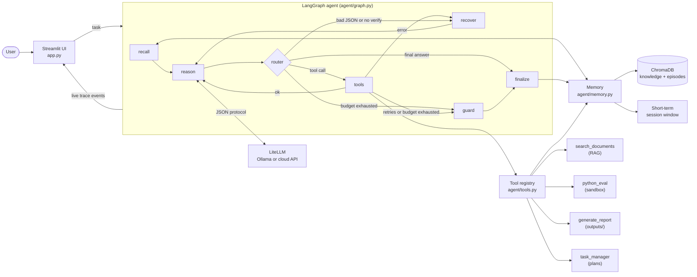

# 🪐 Ashtro-AI

**An autonomous generative-AI assistant for intelligent task automation, contextual reasoning and adaptive workflows.**

Ashtro takes a goal in plain language, then **reasons → plans → acts → verifies** in a LangGraph loop: it searches your local documents (RAG), runs sandboxed Python for exact maths and data analysis, writes Markdown reports, and tracks multi-step plans — recovering from tool failures on its own and showing every step live in a dark-themed Streamlit UI.

- 🔁 **Cyclic ReAct graph** with conditional routing, an error-recovery loop and a hard `max_iterations` guard
- 🧠 **Two-tier memory** — short-term session window + persistent ChromaDB vector memory (documents *and* past episodes)
- 🔌 **Model-agnostic** — local Ollama (`llama3.1`, `qwen2.5`) or any cloud API through LiteLLM, switched by `.env`
- 🛠️ **Four tools** with validated arguments and self-correcting error messages
- 👀 **Transparent** — live "Agent Thought Process" trace: memory recall, reasoning, plan, tool call, observation, verification
- 📊 **Measurable** — 15-task benchmark that scores tool selection, completion and latency

---

## Architecture

### System overview



### Graph nodes

| Node | Responsibility |
| ---- | -------------- |
| `recall` | Loads the session's recent turns and retrieves similar past episodes from long-term memory. |
| `reason` | One LLM call → a strict JSON decision: `reason`, `plan`, `action`, `verify`, `final_answer`. |
| `router` | Deterministic conditional routing: tool call → `tools`; final answer → `finalize`; malformed output or missing verification → `recover`; budget exhausted → `guard`. |
| `tools` | Executes exactly one tool via the safe registry (argument validation + coercion, every exception caught). |
| `recover` | Turns a tool error / malformed reply into corrective guidance and loops back to `reason`. |
| `guard` | Enforces `max_iterations` (and the consecutive-error limit): asks for a best-effort answer with no more tools, with a static fallback. |
| `finalize` | Stores the turn in short-term memory and a summary in episodic memory, emits the final event. |

### The Reason → Plan → Act → Verify protocol

Every model reply is one JSON object (parsed defensively — fences, `<think>` blocks and surrounding prose are tolerated):

```json
{
  "reason": "what I need and what I know",
  "plan": ["step 1", "step 2"],
  "action": {"tool": "python_eval", "args": {"code": "print(2+2)"}},
  "verify": "how the result was checked against the task",
  "final_answer": null
}
```

Exactly one of `action` / `final_answer` is set; `verify` is mandatory with a final answer (the router nudges the model once if it is missing). The JSON protocol is used instead of provider-native tool calling because it behaves consistently across small local models and cloud APIs.

---

## Project structure

```
Ashtro-AI/
├── app.py                   # Streamlit UI with live "Agent Thought Process" logs
├── agent/
│   ├── __init__.py
│   ├── config.py            # Settings loaded from .env (immutable dataclass)
│   ├── llm.py               # LiteLLM client, JSON extraction, friendly connection errors
│   ├── prompts.py           # System prompt enforcing Reason → Plan → Act → Verify
│   ├── graph.py             # LangGraph StateGraph: router, reasoning, tools, recovery, guard
│   ├── tools.py             # 4 tools: RAG search, Python evaluator, report generator, task manager
│   └── memory.py            # Short-term session state + ChromaDB long-term memory
├── data/                    # Sample knowledge base (markdown docs + a CSV for the Python tool)
├── outputs/                 # Reports and files Ashtro generates
├── eval/
│   ├── benchmark_tasks.json # 15 multi-step prompts with tool + answer expectations
│   └── run_eval.py          # Runs the benchmark → accuracy & latency metrics
├── tests/                   # pytest suite (tools, memory, graph flows, eval harness)
├── .streamlit/config.toml   # Dark theme
├── .env.example
├── .gitignore
├── requirements.txt
└── README.md
```

---

## Quick start

Requires **Python 3.10+**.

```bash
# 1. Create an environment and install
python -m venv .venv
source .venv/bin/activate          # Windows PowerShell: .venv\Scripts\Activate.ps1
pip install -r requirements.txt

# 2. Configure
cp .env.example .env               # Windows: copy .env.example .env

# 3. Run (from the project root so the dark theme in .streamlit/ is picked up)
streamlit run app.py
```

### Option A — local model with Ollama (no API key)

```bash
ollama pull llama3.1               # or: ollama pull qwen2.5
ollama serve                       # skip if the Ollama app is already running
```

`.env` defaults already point at it:

```ini
LLM_MODEL=ollama_chat/llama3.1
LLM_API_BASE=http://localhost:11434
```

> Use a model with solid instruction-following (7–8B or larger). Very small models may need more recovery loops.

### Option B — cloud API

```ini
LLM_MODEL=openai/gpt-4o-mini           # or anthropic/claude-sonnet-5-5, any LiteLLM model string
LLM_API_BASE=                          # empty for cloud
OPENAI_API_KEY=sk-...                  # the key variable your provider uses
```

You can also change the model, endpoint, temperature and iteration cap live in the sidebar and press **Test connection**.

The first run downloads the `all-MiniLM-L6-v2` embedding model (~90 MB). If it can't be loaded (offline machine), Ashtro warns in the UI and falls back to offline hashing embeddings — retrieval still works, but is lexical rather than semantic. Set `EMBEDDING_BACKEND=hash` to choose this deliberately.

---

## Using the app

| Tab | What you can do |
| --- | --------------- |
| 💬 **Chat** | Ask anything, or click a starter prompt. While Ashtro works, the **Agent Thought Process** panel streams each step with colour-coded badges (`MEMORY` `REASON` `PLAN` `ACT` `OBSERVE` `VERIFY` `RECOVER`), tool arguments, tool output, per-step timing and a live "running tool…" indicator. It collapses when done and stays inspectable on every past answer. |
| 📚 **Knowledge & Memory** | Upload `.md`/`.txt` files, re-index, try semantic search with relevance scores, browse and clear episodic memory. |
| 📁 **Outputs** | Preview, download or delete files Ashtro generated. |
| ✅ **Tasks** | A kanban view of the session's task plan; move tasks between *To do / In progress / Blocked / Done* by hand. |

Try these (they work against the bundled sample data):

- *"According to the company handbook, how many remote days are allowed, and what are the core hours?"*
- *"Using quarterly_sales.csv, which region had the highest revenue, and by how much did Q4 beat Q1?"*
- *"Estimate the Aurora Sensor Hub's battery life in days at the default duty cycle, and save it as battery_note.md"*
- *"Make a task plan for responding to a SEV1 incident, then mark the first task in progress."*

---

## Tools

| Tool | Purpose | Notable safeguards |
| ---- | ------- | ------------------ |
| `search_documents(query, top_k)` | Semantic RAG over `data/*.md\|txt` (heading-aware chunks, cosine similarity, source + section in results). | Auto-indexes on first use; low-relevance warning; empty-query error. |
| `python_eval(code)` | Exact maths / statistics / data analysis. `numpy`, `pandas`, `math`, `statistics`, … allowed; `load_csv("file.csv")` loads from `data/`. | See *Sandbox* below. |
| `generate_report(filename, content, title, mode)` | Writes `.md/.txt/.csv/.json` into `outputs/` with a title + timestamp header. | Directory parts stripped, extension allow-list, 500 KB cap, overwrite/append modes. |
| `task_manager(action, …)` | `plan`, `add`, `update`, `next`, `list`, `clear` — a per-session task board persisted as JSON. | Coerces loose LLM arguments (ids as strings, steps as bullet text); descriptive errors listing valid ids/statuses. |

**Error handling.** Every call goes through `ToolRegistry.execute`, which validates arguments (unknown tool → lists available tools; missing/unknown/mistyped argument → names the valid parameters; bad enum → lists the options), catches *all* exceptions, and returns `ERROR: … Hint: …` text. The graph routes failures through `recover`, which hands the message back to the model so it can fix its call instead of crashing the run.

### Sandbox (`python_eval`) — read this

The evaluator is **defence in depth, not a hardened security boundary**: AST screening (no dunder access, `open`/`eval`/`exec`, file readers/writers, non-allow-listed imports), a stripped builtins table and module namespaces, execution in a fresh `python -I` subprocess with CPU/memory/file-write limits (POSIX), a scrubbed environment (API keys are not passed in) and a wall-clock timeout. That is appropriate for a single-user local tool driven by your own prompts. If you expose Ashtro to untrusted users, run it inside a container or VM.

---

## Memory & RAG

- **Short-term:** the last `SHORT_TERM_TURNS` turns per session are replayed to the model, so follow-ups ("now save that as a file") work.
- **Knowledge index:** Markdown/text in `data/` is chunked by heading (breadcrumb prefix, ~900 chars, overlap), embedded with `sentence-transformers`, and stored in a persistent ChromaDB collection under `.ashtro/`. Indexing is incremental — unchanged files are skipped, edited files are re-chunked, deleted files are removed.
- **Episodic memory:** after each *successful* run, Ashtro stores a short summary (task, outcome, tools used). Similar future requests recall them above `MEMORY_MIN_SCORE` and see them as "hints, may be outdated". Toggle it in the sidebar or with `ENABLE_EPISODIC_MEMORY`.
- Collections are namespaced by embedding backend, so switching models never mixes incompatible vectors.

---

## Configuration

All settings live in `.env` (see [`.env.example`](.env.example)):

| Variable | Default | Description |
| -------- | ------- | ----------- |
| `LLM_MODEL` | `ollama_chat/llama3.1` | Any LiteLLM model string. |
| `LLM_API_BASE` | `http://localhost:11434` | Endpoint; leave empty for cloud providers. |
| `LLM_API_KEY` | – | Optional generic key override (provider-specific variables also work). |
| `LLM_TEMPERATURE` / `LLM_MAX_TOKENS` / `LLM_TIMEOUT` / `LLM_RETRIES` | `0.1` / `2048` / `120` / `2` | Generation and transport settings. |
| `LLM_JSON_MODE` | `true` | Request JSON output; auto-retries without it if the provider rejects it. |
| `AGENT_MAX_ITERATIONS` | `8` | Hard cap on reasoning steps per task. |
| `AGENT_MAX_TOOL_RETRIES` | `3` | Consecutive failures tolerated before the guard stops the run. |
| `EMBEDDING_BACKEND` / `EMBEDDING_MODEL` | `sentence-transformers` / `all-MiniLM-L6-v2` | Or `hash` for offline lexical embeddings. |
| `RAG_TOP_K`, `MEMORY_MIN_SCORE`, `ENABLE_EPISODIC_MEMORY`, `SHORT_TERM_TURNS` | `4`, `0.35`, `true`, `6` | Retrieval and memory behaviour. |
| `PYTHON_TOOL_TIMEOUT` | `10` | Seconds before the Python tool is killed. |

---

## Evaluation

`eval/benchmark_tasks.json` holds **15 multi-step prompts** grounded in the sample data, covering plain RAG, Python and CSV analysis, RAG + calculation, RAG/Python → report, task planning, and one *no-tool* question to check restraint.

```bash
python -m eval.run_eval                                   # uses your .env model
python -m eval.run_eval --model ollama_chat/qwen2.5       # try another model
python -m eval.run_eval --ids 1,7,9 --verbose             # subset, with answers
python -m eval.run_eval --update-readme                   # refresh the table below
```

Runs are isolated (own state/outputs folders, episodic memory off by default) and write JSON + a Markdown summary to `eval/results/`.

**Scoring**

- **Tool selection** ✔ when `required ⊆ used ⊆ required ∪ optional` — every expected tool was called, and nothing else (hallucinated tool names count against it).
- **Completion** ✔ when the run ended `ok` *and* every regex on the final answer / tool outputs matches, expected files exist with the right content, and minimum call counts are met. Numbers are compared after stripping thousands separators.
- **Strict success** = both. **Latency** = wall-clock per task (avg / median / p95), excluding one-off index build.

### Benchmark results

<!-- BENCHMARK:START -->
| Model | Tool selection | Completion | Strict success | Avg latency | p95 latency | Avg steps |
| ----- | -------------- | ---------- | -------------- | ----------- | ----------- | --------- |
| _not run yet_ | – | – | – | – | – | – |
<!-- BENCHMARK:END -->

> The table is generated by `--update-readme` from real runs on your hardware and model — latency in particular depends heavily on both. The test suite also replays an "oracle" model through all 15 tasks to verify the harness and the sample-data ground truth, but that is a correctness check of the benchmark itself, not a model score.

---

## Testing

```bash
pip install pytest
python -m pytest -q
```

The suite uses a scripted fake LLM and offline hashing embeddings (no network, no model needed) and covers: tool validation and sandbox escapes, chunking / incremental indexing / retrieval ranking, episodic + short-term memory, every graph path (direct answer, tool loop, error recovery, unknown tool, malformed JSON, missing verify, error-limit guard, `max_iterations` guard, LLM outage) and the eval harness.

---

## Extending Ashtro

Add a tool by appending a `ToolSpec` in `agent/tools.py`; the prompt documentation, argument validation and error handling come for free:

```python
def word_count(ctx: ToolContext, text: str) -> ToolResult:
    return ToolResult(ok=True, output=str(len(text.split())))

ToolSpec(
    name="word_count",
    description="Count the words in a piece of text.",
    params={"text": Param("string", "Text to count.")},
    func=lambda ctx, text: word_count(ctx, text),
    example='{"tool":"word_count","args":{"text":"hello world"}}',
)
```

To grow the knowledge base, drop `.md`/`.txt` files into `data/` (or upload them in the UI).

---

## Troubleshooting

| Symptom | Fix |
| ------- | --- |
| *"Cannot reach Ollama…"* | Run `ollama serve`; check `LLM_API_BASE`; `ollama pull <model>`. |
| *"Authentication failed…"* | Set the provider key in `.env` and empty `LLM_API_BASE`. |
| Model keeps sending malformed JSON | Use a stronger/larger model, lower `LLM_TEMPERATURE`, or raise `AGENT_MAX_ITERATIONS`. The trace shows each `RECOVER` attempt. |
| Light-coloured widgets | Start Streamlit from the project root so `.streamlit/config.toml` is loaded. |
| Retrieval looks keyword-only | The embedding model couldn't load and the hashing fallback is active (see the amber pill in the header). |
| Stale answers after editing docs | Click **Re-index** in *Knowledge & Memory* (changed files are detected automatically on re-index). |
